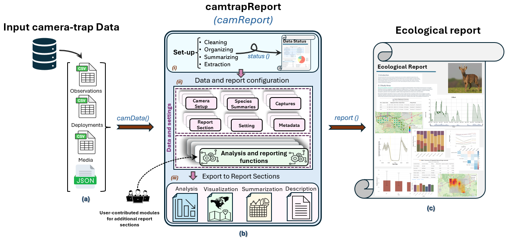

---
output:
  github_document:
    html_preview: false
---

<!-- README.md is generated from README.Rmd. Edit README.Rmd, not README.md. -->

```{r setup, include=FALSE}
knitr::opts_chunk$set(
  collapse = TRUE,
  comment = "#>",
  fig.path = "man/figures/README-",
  out.width = "100%"
)

options(
  width = 80,
  knitr.duplicate.label = "allow"
)
```

<h1 align="center">camtrapReport</h1>

<p align="center">
  <em>Reproducible reporting for camera-trap monitoring data</em>
</p>

<p align="center">
  <a href="https://github.com/spatialecology/camtrapReport/actions/workflows/R-CMD-check.yaml"></a>
  <a href="https://github.com/spatialecology/camtrapReport/actions/workflows/pkgcheck.yaml"></a>
  <a href="https://github.com/ropensci/software-review/issues/799"></a>
  <a href="https://app.codecov.io/github/spatialecology/camtrapReport"></a>
  <a href="https://www.repostatus.org/#active"></a>
  <a href="https://www.r-project.org/"></a>
  <a href="https://github.com/spatialecology/camtrapReport/blob/main/LICENSE.md"></a>
  <a href="https://spatialecology.github.io/camtrapReport/"></a>
</p>

---

`camtrapReport` transforms camera-trap data in [Camtrap DP](https://camtrap-dp.tdwg.org/) format into two complementary reports:

- **Data Status Check** — assesses data completeness, consistency, annotation quality, and spatiotemporal coverage, highlighting issues that require attention.
- **Ecological Report** — integrates selected ecological analyses, figures, tables, maps, and automatically generated explanatory text informed by the data, metadata, and analytical results.

A `camReport` object brings together input data, settings, and reusable reporting modules. Users can select and customize sections, or develop modules and Analytical Profiles for particular monitoring workflows. The package complements, rather than replaces, tools for camera-trap data management and specialized ecological analysis.

<p align="center">
  
  <br>
  <em>Overview of the camtrapReport workflow, from standardized camera-trap data to automated reporting.</em>
</p>

## Use in practice

The package has been developed and tested with camera-trap datasets from monitoring sites across five continents, including the [European Observatory of Wildlife (EOW)](https://enetwild.com/). These applications inform software development but do not constitute formal validation of ecological estimates or a systematic usability assessment. See [Resources](https://spatialecology.github.io/camtrapReport/articles/resources.html).

## Installation

`camtrapReport` requires R 4.1.0 or later. Install it from GitHub using [`pak`](https://pak.r-lib.org/):

```r
if (!requireNamespace("pak", quietly = TRUE)) {
  install.packages("pak")
}

pak::pkg_install("spatialecology/camtrapReport")
```

Some modules require additional R packages. To install optional dependencies for available modules, run:

```r
camtrapReport::install_all()
```

Work directly in R or use the optional Shiny interface, `gui(cm)`. Report-generation time depends on dataset size and selected analyses.

## Prepare the input

Provide a [Camtrap DP](https://camtrap-dp.tdwg.org/) dataset as a directory or ZIP archive. Convert other formats to Camtrap DP before import (e.g., with [Biowatch](https://biowatch.earthtoolsmaker.org/) or a custom workflow). Check compliance with the [Camtrap DP specification](https://camtrap-dp.tdwg.org/); the Data Status Check is not a full schema validator.

## Quick start

The example uses a bundled subset of **GMU8_LEUVEN**, with habitat data and a study-area boundary. Input files are copied to a writable temporary directory because processing may create files alongside the dataset.

```{r quick-start}
library(camtrapReport)

# Prepare the example data
example_root <- tempfile("camtrapReport-example-")
dir.create(example_root)

file.copy(
  system.file("external", "dataset", package = "camtrapReport"),
  example_root,
  recursive = TRUE
)

habitat <- read.csv(
  system.file("external", "habitat", "habitat.csv", package = "camtrapReport")
)

study_area <- system.file(
  "external", "study_area", "study_area.shp",
  package = "camtrapReport"
)

# Create a camReport object
cm <- camData(
  data = file.path(example_root, "dataset"),
  habitat = habitat,
  study_area = study_area,
  update = TRUE
)

cm
```

`camData()` accepts a Camtrap DP directory or ZIP archive. Optional habitat and study-area inputs support additional formats; see `?camData` for details.

**Generated files:** `camData()` may save processed files alongside the input dataset. Use `update = TRUE` to refresh cached data after changes. This example uses a temporary copy to preserve the bundled dataset.

### Generate a Data Status Check

`status()` generates a Data Status Check summarizing spatial and temporal coverage, data completeness, classification consistency, and annotation quality. It highlights potential issues requiring attention before ecological analysis.

```{r generate-data-status, message=FALSE, warning=FALSE}
status_file <- status(cm, view = FALSE)
```

[**View example Data Status Check**](https://spatialecology.github.io/camtrapReport/reports/DataStatusReport_example.html)

```{r validate-data-status, include=FALSE}
stopifnot(
  is.character(status_file),
  length(status_file) == 1L,
  file.exists(status_file)
)
```

### Generate an Ecological Report

`report()` combines selected modules, tables, figures, maps, and data-informed narratives into a reproducible Ecological Report. Modules can be selected, reordered, or extended. The function returns the output path; `view = TRUE` opens the completed report.

```{r generate-ecological-report, message=FALSE, warning=FALSE}
report_file <- report(
  cm,
  view = FALSE
)
```

[**View example Ecological Report**](https://spatialecology.github.io/camtrapReport/reports/EcologicalReport_example.html)

```{r validate-ecological-report, include=FALSE}
stopifnot(
  is.character(report_file),
  length(report_file) == 1L,
  file.exists(report_file)
)
```

## Available analyses

Built-in modules cover study-area and sampling descriptions, camera locations, sampling effort, image and data processing, species detections and capture-based indices, species richness and accumulation, co-occurrence, activity patterns, habitat associations, spatial detection intensity, and Random Encounter Model (REM) density estimation. Outputs depend on the available data, module requirements, and methodological assumptions.

Explore the [**Module Catalog**](https://spatialecology.github.io/camtrapReport/articles/module-catalog.html) for modules, methods, settings, and brief implementation details. Use `section_names()` to inspect available sections in R.

## Analytical Profiles

Standardized data can yield different ecological estimates when analytical choices differ. **Analytical Profiles** specify reusable selections of modules, methods, settings, assumptions, and reporting conventions to improve consistency across sites and monitoring rounds.

Alongside the default profile, *camtrapReport* provides an **EOW-oriented profile** configured for European Observatory of Wildlife monitoring. Additional profiles are under development; users can define and share their own without implying formal network endorsement.

See the [**Profiles guide**](https://spatialecology.github.io/camtrapReport/articles/profiles.html) or `?reportProfile`. To propose a workflow for your network, join [GitHub Discussions](https://github.com/spatialecology/camtrapReport/discussions).

## Configure a report

Inspect metadata and select report modules (this changes the sections used in subsequent reports):

```{r configure-report, message=FALSE, warning=FALSE, results='hide'}
info(cm, name = c("title", "authors"))

selected_sections <- section_names(
  keep = c(
    "introduction",
    "methods",
    "study_area",
    "sampling",
    "effort"
  )
)

sections(cm, selected_sections)
```

### Customize report content

Modules may combine predefined narrative templates, Camtrap DP metadata, and computed results. Review generated text before publication. Customize modules in a writable project directory rather than editing installed package files; see [Module management](https://spatialecology.github.io/camtrapReport/articles/modules.html).

### Graphical user interface

Use `gui(cm)` to edit report metadata, select modules, and generate reports interactively. The R interface supports further customization.

## Interpretation and reproducibility

A completed **Data Status Check** does not establish suitability for ecological inference. Interpret results in light of sampling effort, detectability, spatial and temporal coverage, and method-specific assumptions.

Retain source data, additional inputs, selected modules, analytical settings, and package versions for reproducibility. Review maps and outputs for sensitive species locations before sharing.

**Taxonomy enrichment:** By default, `camData()` may send species names to GBIF to fill missing classifications. Set `enrich_taxonomy = FALSE` to disable these requests when importing; use `update = TRUE` to rebuild an existing cache with the revised setting. Missing classifications can affect taxonomic-group filters. See `?camData`.

## Example-data provenance

The bundled example is a reduced subset of the [GMU8_LEUVEN Camtrap DP dataset](https://doi.org/10.15468/4u3wm4), published by INBO through GBIF. It contains 8 locations, 87 deployments, 15,492 retained media records, and 11,092 observations. This derived dataset is for demonstration and testing, **not ecological inference**. See the [preparation notes](https://github.com/spatialecology/camtrapReport/blob/main/inst/external/README-Leuven-dataset.md).

## Relationship to other camera-trap packages

[`camtrapdp`](https://inbo.github.io/camtrapdp/) supports Camtrap DP data validation and transformation; [`camtraptor`](https://inbo.github.io/camtraptor/) supports data exploration; and [`camtrapR`](https://jniedballa.github.io/camtrapR/) and [`ct`](https://cran.r-project.org/package=ct) support broader camera-trap workflows. *camtrapReport* complements these tools by assembling data-status diagnostics, ecological analyses, and explanatory narratives into modular reports.

## Documentation and support

- [Package overview](https://spatialecology.github.io/camtrapReport/articles/Package-Overview.html)
- [Data Status Check](https://spatialecology.github.io/camtrapReport/articles/data-status-report.html)
- [Ecological Report](https://spatialecology.github.io/camtrapReport/articles/ecological-report.html)
- [Module Catalog](https://spatialecology.github.io/camtrapReport/articles/module-catalog.html)
- [Analytical Profiles](https://spatialecology.github.io/camtrapReport/articles/profiles.html)
- [Module management](https://spatialecology.github.io/camtrapReport/articles/modules.html)
- [Function reference](https://spatialecology.github.io/camtrapReport/reference/index.html)
- [Issues and feature requests](https://github.com/spatialecology/camtrapReport/issues)

## Citation

```{r citation, eval=FALSE}
citation("camtrapReport")
```

## Author

*camtrapReport* is developed and maintained by [Elham Ebrahimi](https://orcid.org/0000-0001-5191-9832).

## Contributing

Contributions to code, documentation, modules, and Analytical Profiles are welcome. See the [contributing guidelines](https://github.com/spatialecology/camtrapReport/blob/main/.github/CONTRIBUTING.md) and [Code of Conduct](https://github.com/spatialecology/camtrapReport/blob/main/.github/CODE_OF_CONDUCT.md).

```{r cleanup, include=FALSE}
unlink(
  example_root,
  recursive = TRUE,
  force = TRUE
)
```
