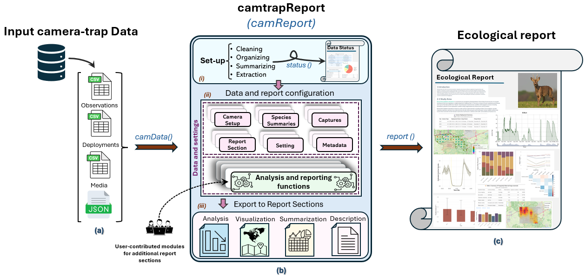

<!-- README.md is generated from README.Rmd. Edit README.Rmd, not README.md. -->

<h1 align="center">

camtrapReport
</h1>

<p align="center">

<em>Reproducible reporting for camera-trap monitoring data</em>
</p>

<p align="center">

<a href="https://github.com/spatialecology/camtrapReport/actions/workflows/R-CMD-check.yaml"></a>
<a href="https://github.com/spatialecology/camtrapReport/actions/workflows/pkgcheck.yaml"></a>
<a href="https://github.com/ropensci/software-review/issues/799"></a>
<a href="https://boninabox.geobon.org/tool-detail?id=253"></a>
<a href="https://app.codecov.io/github/spatialecology/camtrapReport"></a>
<a href="https://camera-traps.r-universe.dev/camtrapReport"></a>
<a href="https://www.repostatus.org/#active"></a>
<a href="https://www.r-project.org/"></a>
<a href="https://github.com/spatialecology/camtrapReport/blob/main/LICENSE.md"></a>
<a href="https://spatialecology.github.io/camtrapReport/"></a>
</p>

------------------------------------------------------------------------

`camtrapReport` transforms camera-trap data in [Camtrap
DP](https://camtrap-dp.tdwg.org/) format into two complementary reports:

- **Data Status Check** — assesses data completeness, consistency,
  annotation quality, and spatiotemporal coverage, highlighting issues
  that require attention.
- **Ecological Report** — integrates selected ecological analyses,
  figures, tables, maps, and automatically generated explanatory text
  informed by the data, metadata, and analytical results.

A `camReport` object brings together input data, settings, and reusable
reporting modules. Users can select and customize sections, or develop
modules and Analytical Profiles for particular monitoring workflows. The
package complements, rather than replaces, tools for camera-trap data
management and specialized ecological analysis.

The optional graphical interface `gui()` is designed to make these
workflows accessible to users with different levels of programming
experience. Shiny is used only for this interface; code-based workflows
using `camData()`, `report()`, and `status()` do not require launching
Shiny.

<p align="center">


<br> <em> Overview of the camtrapReport workflow, from standardized
camera-trap data to automated reporting. See the
<a href="https://spatialecology.github.io/camtrapReport/articles/data-status-report.html">Data
Status Check</a>,
<a href="https://spatialecology.github.io/camtrapReport/articles/ecological-report.html">Ecological
Report</a>, and
<a href="https://spatialecology.github.io/camtrapReport/articles/modules.html">Module
Management</a> guides for the corresponding components of the workflow.
</em>
</p>

## Use in practice

The package has been developed and tested with camera-trap datasets from
monitoring sites across five continents, including the [European
Observatory of Wildlife (EOW)](https://enetwild.com/). These
applications inform software development but do not constitute formal
validation of ecological estimates or a systematic usability assessment.
See
[Resources](https://spatialecology.github.io/camtrapReport/articles/resources.html).

## Installation

`camtrapReport` requires R 4.1.0 or later. Install it from GitHub using
[`pak`](https://pak.r-lib.org/):

``` r
if (!requireNamespace("pak", quietly = TRUE)) {
  install.packages("pak")
}

pak::pkg_install("spatialecology/camtrapReport")
```

Alternatively, install the package from R-universe:

``` r
install.packages(
  "camtrapReport",
  repos = c(
    "https://camera-traps.r-universe.dev",
    "https://cloud.r-project.org"
  )
)
```

Some modules require additional R packages. To install optional
dependencies for available modules, run:

``` r
camtrapReport::install_all()
```

Use the R functions directly, or configure and generate reports through
the optional Shiny interface, `gui(cm)`. Shiny is not needed to run the
R workflow. Report-generation time depends on dataset size and selected
analyses.

## Prepare the input

Provide a [Camtrap DP](https://camtrap-dp.tdwg.org/) dataset as a
directory or ZIP archive. The main dataset cannot currently be supplied
as in-memory R tables; optional habitat and study-area inputs can be R
objects. Convert other formats to Camtrap DP before import (e.g., with
[Biowatch](https://biowatch.earthtoolsmaker.org/) or a custom workflow).

**Input validation:** `camtrapReport` expects datasets in [Camtrap
DP](https://camtrap-dp.tdwg.org/) format but does not perform full
schema validation during import. Data exported directly from platforms
such as [Agouti](https://doi.org/10.3897/biss.3.46690) already follow
this standard. For datasets created or modified independently, users are
encouraged to validate compliance with the Camtrap DP specification
before calling `camData()`. The Data Status Check generated by
`status()` assesses data completeness and consistency but does not
replace schema validation.

## Quick start

The example uses a bundled subset of **GMU8_LEUVEN**, with habitat data
and a study-area boundary. Input files are copied to a temporary
directory so the example can run independently of the installed package
files.

``` r
library(camtrapReport)

# Prepare the example data
example_root <- tempfile("camtrapReport-example-")
dir.create(example_root)

file.copy(
  system.file("external", "dataset", package = "camtrapReport"),
  example_root,
  recursive = TRUE
)
#> [1] TRUE

habitat <- read.csv(
  system.file("external", "habitat", "habitat.csv", package = "camtrapReport")
)

study_area <- system.file(
  "external", "study_area", "study_area.shp",
  package = "camtrapReport"
)

# Create a camReport object
cm <- camData(
  data = file.path(example_root, "dataset"),
  habitat = habitat,
  study_area = study_area,
  update = TRUE
)
#> The camReport object is being created...
#> Dataset size: 6.6 MB.
#> File size looks modest, but full object creation may still take several minutes depending on the number of records.
#> Taxonomic class is unavailable for 43 recorded taxa. Class-dependent groups and mammal counts may be incomplete; missing classification does not indicate ecological absence. Supply source classifications or explicitly enable GBIF enrichment and rebuild with update = TRUE.
#> Setup is done!
#> Data loaded successfully in 29 sec.
#> camReport object is ready for GMU8 LEUVEN.

cm
#> Camera trap Object for the site : GMU8 LEUVEN 
#> ===================================================== 
#> Total number of sequences       :  10182 
#> Total number of observations    :  10798 
#> Total number of animals         :  4693 
#> Total number of detected species:  41 
#> Date/time (years) with data     :  2018, 2019, 2020, 2021, 2022, and 2023 
#> -----------------------------------------------------
```

`camData()` accepts a Camtrap DP directory or ZIP archive. Optional
habitat and study-area inputs support additional formats; see `?camData`
for details.

### File storage and caching

Earlier versions could create `__camReport_Object.rds` (a
processed-object cache) and `study_area.map` (a saved study-area
boundary) beside the dataset. Current folder imports do not create
either file automatically. Existing legacy caches remain readable, and
existing `study_area.map` files are left untouched; study areas remain
in memory unless explicitly saved.

By default, `camData()` reads folder-based datasets without modifying
the input files or creating a cache. To save the processed object for
reuse, specify `cache_file`. Two alternative input methods are shown
below:

``` r
# From a folder
cm <- camData(
  "path/to/dataset",
  cache_file = "path/to/output/analysis.rds"
)

# Alternatively, from a ZIP archive
cm <- camData(
  "path/to/dataset.zip",
  path = "path/to/output",
  cache_file = "path/to/output/analysis.rds"
)
```

The output directory must already exist. To reuse a saved object,
provide the same `cache_file`; to rebuild it, use
`update = TRUE, overwrite = TRUE`. Legacy `__camReport_Object.rds`
caches remain readable. For ZIP imports, keep the extracted files in a
persistent directory to preserve source and image paths across sessions.
To retain generated reports, specify an output filename; otherwise,
outputs are temporary. In the GUI, select an output directory before
importing ZIP files or saving results.

### Generate a Data Status Check

`status()` generates a Data Status Check summarizing spatial and
temporal coverage, data completeness, classification consistency, and
annotation quality. It highlights potential issues requiring attention
before ecological analysis.

``` r
status_file <- status(cm, view = FALSE)
```

[**View example Data Status
Check**](https://spatialecology.github.io/camtrapReport/reports/DataStatusReport_example.html)

### Generate an Ecological Report

`report()` combines selected modules, tables, figures, maps, and
data-informed narratives into a reproducible Ecological Report. Modules
can be selected, reordered, or extended. The function returns the output
path; `view = TRUE` opens the completed report.

``` r
report_file <- report(
  cm,
  view = FALSE
)
if (inherits(report_file, "try-error")) {
  stop(as.character(report_file), call. = FALSE)
}
```

[**View example Ecological
Report**](https://spatialecology.github.io/camtrapReport/reports/EcologicalReport_example.html)

## Available analyses

Built-in modules cover study-area and sampling descriptions, camera
locations, sampling effort, image and data processing, species
detections and capture-based indices, species richness and accumulation,
co-occurrence, activity patterns, habitat associations, spatial
detection intensity, and Random Encounter Model (REM) density
estimation. Outputs depend on the available data, module requirements,
and methodological assumptions.

Explore the [**Module
Catalog**](https://spatialecology.github.io/camtrapReport/articles/module-catalog.html)
to compare available modules in the Data Status Check, default (Global)
and EOW reports, including methods, required inputs, and settings. Some
sections depend on optional packages, data availability, or analytical
prerequisites and may be absent from a particular report. Use
`section_names()` to inspect available sections in R.

## Analytical Profiles

Standardized data can yield different ecological estimates when
analytical choices differ. **Analytical Profiles** specify reusable
selections of modules, methods, settings, assumptions, and reporting
conventions to improve consistency across sites and monitoring rounds.

Alongside the default profile, *camtrapReport* provides an
**EOW-oriented profile** configured for European Observatory of Wildlife
monitoring. Additional profiles are under development; users can define
and share their own without implying formal network endorsement.

See the [**Profiles
guide**](https://spatialecology.github.io/camtrapReport/articles/profiles.html)
or `?reportProfile`. To propose a workflow for your network, join
[GitHub
Discussions](https://github.com/spatialecology/camtrapReport/discussions).

## Configure a report

Inspect metadata and select report modules (this changes the sections
used in subsequent reports):

``` r
info(cm, name = c("title", "authors"))

selected_sections <- section_names(
  keep = c(
    "introduction",
    "methods",
    "study_area",
    "sampling",
    "effort"
  )
)

sections(cm, selected_sections)
```

### Customize report content

Modules may combine predefined narrative templates, Camtrap DP metadata,
and computed results; this is where much of the report text originates.
Review generated text before publication. Customize existing modules or
add new ones in a writable project directory rather than editing
installed package files; see [Module
management](https://spatialecology.github.io/camtrapReport/articles/modules.html).

### Graphical user interface

Use `gui(cm)` to edit report metadata, select modules, and generate
reports interactively. The R interface supports further customization.

## Interpretation and reproducibility

A completed **Data Status Check** does not establish suitability for
ecological inference. Interpret results in light of sampling effort,
detectability, spatial and temporal coverage, and method-specific
assumptions.

Retain source data, additional inputs, selected modules, analytical
settings, and package versions for reproducibility. Review maps and
outputs for sensitive species locations before sharing.

**Taxonomy enrichment:** `camData()` defaults to
`enrich_taxonomy = FALSE` and makes no GBIF requests. Set
`enrich_taxonomy = TRUE` explicitly to send species names to GBIF and
fill missing classifications; existing source classifications are
preserved. Use `update = TRUE` to rebuild an existing cache with the
revised setting. Missing classifications can affect taxonomic-group
filters. See `?camData`.

## Example-data provenance

The bundled example is a reduced subset of the [GMU8_LEUVEN Camtrap DP
dataset](https://doi.org/10.15468/4u3wm4), published by INBO through
GBIF. It contains 8 locations, 87 deployments, 15,492 retained media
records, and 11,092 observations. This derived dataset is for
demonstration and testing, **not ecological inference**. See the
[preparation
notes](https://github.com/spatialecology/camtrapReport/blob/main/inst/external/README-Leuven-dataset.md).

## Relationship to other camera-trap packages

[`camtrapdp`](https://inbo.github.io/camtrapdp/) supports Camtrap DP
data validation and transformation;
[`camtraptor`](https://inbo.github.io/camtraptor/) supports data
exploration; and [`camtrapR`](https://jniedballa.github.io/camtrapR/)
and [`ct`](https://cran.r-project.org/package=ct) support broader
camera-trap workflows. *camtrapReport* complements these tools by
assembling data-status diagnostics, ecological analyses, and explanatory
narratives into modular reports.

## Documentation and support

- [Package
  overview](https://spatialecology.github.io/camtrapReport/articles/Package-Overview.html)
- [Data Status
  Check](https://spatialecology.github.io/camtrapReport/articles/data-status-report.html)
- [Ecological
  Report](https://spatialecology.github.io/camtrapReport/articles/ecological-report.html)
- [Module
  Catalog](https://spatialecology.github.io/camtrapReport/articles/module-catalog.html)
- [Analytical
  Profiles](https://spatialecology.github.io/camtrapReport/articles/profiles.html)
- [Module
  management](https://spatialecology.github.io/camtrapReport/articles/modules.html)
- [Function
  reference](https://spatialecology.github.io/camtrapReport/reference/index.html)
- [Issues and feature
  requests](https://github.com/spatialecology/camtrapReport/issues)

## Citation

``` r
citation("camtrapReport")
```

## Author

*camtrapReport* is developed and maintained by [Elham
Ebrahimi](https://orcid.org/0000-0001-5191-9832).

## Contributing

Contributions to code, documentation, modules, and Analytical Profiles
are welcome. See the [contributing
guidelines](https://github.com/spatialecology/camtrapReport/blob/main/.github/CONTRIBUTING.md)
and [Code of
Conduct](https://github.com/spatialecology/camtrapReport/blob/main/.github/CODE_OF_CONDUCT.md).

### Reproduce a GUI workflow

Select an output directory in the GUI. Reports and their analytical R
Markdown sources go in `GUI/reports/`, separately saved objects in
`GUI/objects/`, and GUI ZIP imports in `GUI/data/`. Direct `report()`
and `status()` calls retain their existing destination rules.

In **Generate**, choose **Export Reproducible Workflow**. This saves the
current configured object and both report types with attached modules
under `GUI/reproducibility/`, together with `reproduce.R`,
`reproduce.Rmd`, required local assets, a manifest and
`sessionInfo.txt`. Further exports use numbered subdirectories; earlier
bundles are never replaced. Move the whole bundle, install the recorded
camtrapReport version and dependencies, then run:

``` sh
Rscript reproduce.R
```

Alternatively, use `rmarkdown::render("reproduce.Rmd")`. The document
launches the same script in a fresh R process. The first run writes
`reports/`; later runs write `reports/run-001/`, etc., preserving
previous reports. Rendering the R Markdown again replaces its summary
`reproduce.html` only.

This is **snapshot-based report regeneration**, using stored inputs,
settings, selected modules, edited narrative, spatial objects and model
caches. Existing report functions determine what is recalculated; cache
reuse is not independent model refitting. Full reproduction from
original Camtrap-DP inputs requires import/construction provenance and
remains a future enhancement.

Local logos and required cached appendix photographs are included.
Missing required assets block export. Online basemap imagery and
arbitrary external resources in custom modules cannot be archived
automatically; use self-contained trusted modules for portable
reproduction. Pandoc and selected modules’ optional packages are
required. The exported README explains version and asset limits.

**Review before sharing:** objects and reports can contain sensitive
species locations, observations and project metadata. Export never
uploads data.
