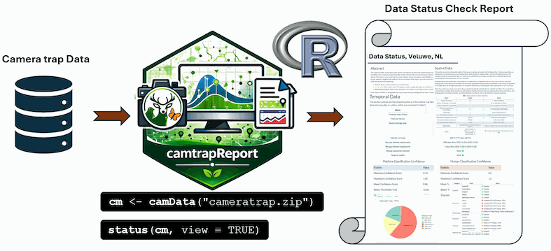
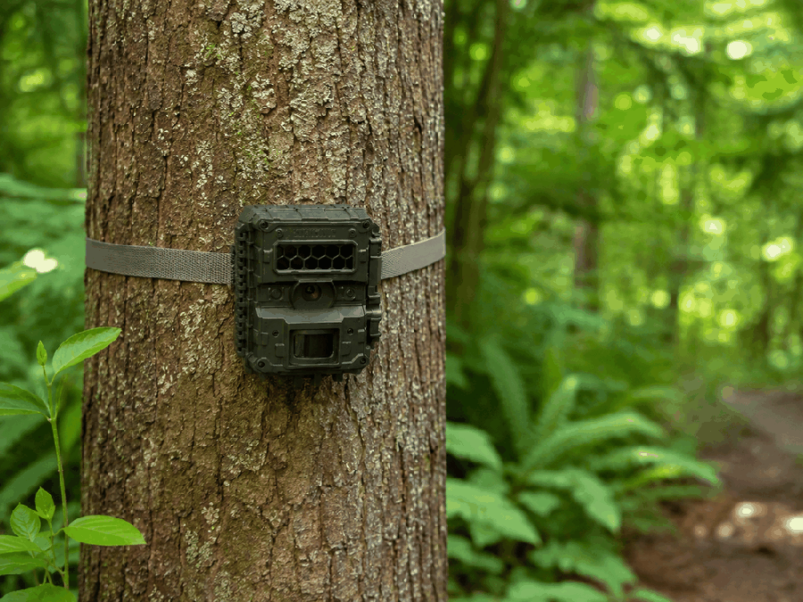
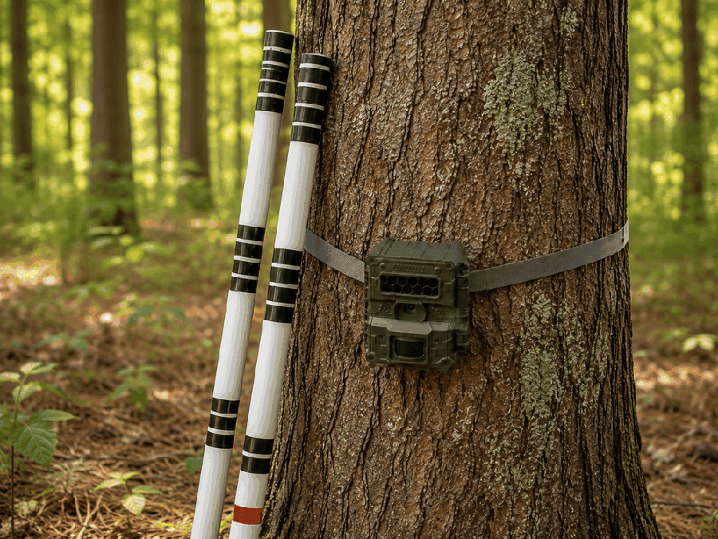

## Assess data quality before ecological reporting

The **Data Status Check** summarises the completeness, consistency, annotation quality, and spatial and temporal coverage of camera-trap datasets in [Camtrap DP](https://camtrap-dp.tdwg.org/) format. It highlights potential issues to review before ecological analysis, but does not replace formal schema validation or establish suitability for ecological inference.

<style>
.figure .caption,
figcaption,
p.caption {
  text-align: center;
  font-size: 0.85rem;
  font-weight: 500;
  color: #555555;
}
</style>

```{r data-status-workflow, echo=FALSE, out.width="100%", fig.align="center", fig.cap="Figure 1. From Camtrap DP input to data-quality review and ecological reporting.", fig.alt="Workflow for generating a Data Status Check from camera-trap data using camtrapReport."}

```

## Generate a Data Status Check

The example uses a writable copy of the bundled dataset to avoid creating files inside the installed package.

```{r data-status-basic-code, eval=FALSE}
library(camtrapReport)

# Prepare a writable copy of the example data
example_root <- tempfile("camtrapReport-example-")
dir.create(example_root)
file.copy(
  system.file("external", "dataset", package = "camtrapReport"),
  example_root,
  recursive = TRUE
)

# Import and check the dataset
cm <- camData(file.path(example_root, "dataset"))
status(cm, view = TRUE)
```

`status()` generates an HTML report and returns its file path invisibly. Set `view = FALSE` to generate the report without opening it. To specify an output location:

```{r data-status-output-path, eval=FALSE}
dir.create("reports", showWarnings = FALSE)
status_file <- status(
  cm,
  filename = file.path("reports", "data_status_2026"),
  view = FALSE
)
```

**Note:** Existing files with the same name may be overwritten.

### Interpret and act on findings

A flagged issue merits investigation but does not necessarily indicate an error. Review the underlying Camtrap DP files, correct records where needed, and rerun `camData(..., update = TRUE)` followed by `status()`. The check does **not** modify the source dataset. Assess suitability for ecological inference separately before generating `report(cm)`.

<hr class="section-divider">

## Explore example reports

Explore four monitoring projects to see how the Data Status Check presents different datasets. These reports are examples, not universal quality benchmarks.

<style>
.status-gallery {
  display: grid;
  grid-template-columns: repeat(2, minmax(0, 1fr));
  gap: 1.5rem;
  max-width: 1050px;
  margin: 1.8rem auto 2.8rem auto;
}

.status-card {
  position: relative;
  display: block;
  overflow: hidden;
  border-radius: 18px;
  background: #003b32;
  box-shadow: 0 8px 24px rgba(0, 0, 0, 0.16);
  text-decoration: none;
  color: #ffffff !important;
}

.status-card img {
  width: 100%;
  height: 320px;
  object-fit: cover;
  display: block;
  transition: transform 0.25s ease, filter 0.25s ease;
}

.status-card:hover img {
  transform: scale(1.05);
  filter: brightness(1.06);
}

.status-card-overlay {
  position: absolute;
  inset: 0;
  background: linear-gradient(
    to top,
    rgba(0, 0, 0, 0.88),
    rgba(0, 0, 0, 0.42),
    rgba(0, 0, 0, 0.06)
  );
  display: flex;
  flex-direction: column;
  justify-content: flex-end;
  padding: 1.25rem;
}

.status-card .status-card-title {
  margin: 0 0 0.25rem 0;
  color: #ffffff !important;
  font-size: 1.35rem;
  line-height: 1.25;
  font-weight: 800 !important;
  text-shadow: 0 2px 8px rgba(0, 0, 0, 0.85);
}

.status-card .status-card-text {
  margin: 0;
  color: #ffffff !important;
  font-size: 1rem;
  line-height: 1.35;
  font-weight: 700 !important;
  text-shadow: 0 2px 8px rgba(0, 0, 0, 0.85);
}

.status-card .status-card-badge {
  display: inline-block;
  width: fit-content;
  margin-top: 0.75rem;
  padding: 0.30rem 0.80rem;
  border-radius: 999px;
  background: rgba(0, 0, 0, 0.35);
  border: 1px solid rgba(255, 255, 255, 0.75);
  color: #ffffff !important;
  font-size: 0.88rem;
  font-weight: 700 !important;
  text-shadow: 0 1px 5px rgba(0, 0, 0, 0.85);
}

.status-card:hover,
.status-card:focus,
.status-card:hover .status-card-title,
.status-card:hover .status-card-text,
.status-card:hover .status-card-badge {
  color: #ffffff !important;
  text-decoration: none;
}

@media (max-width: 800px) {
  .status-gallery {
    grid-template-columns: 1fr;
    max-width: 560px;
  }

  .status-card img {
    height: 300px;
  }
}
</style>

<div class="status-gallery">

<a class="status-card" href="https://spatialecology.github.io/camtrapReport/reports/leuven-data-status-check.html" target="_blank" rel="noopener noreferrer"><div class="status-card-overlay"><div class="status-card-title">Leuven</div><div class="status-card-text">Data Status Check</div><span class="status-card-badge">Open report</span></div></a>

<a class="status-card" href="https://spatialecology.github.io/camtrapReport/reports/amsterdam-data-status-check.html" target="_blank" rel="noopener noreferrer"><div class="status-card-overlay"><div class="status-card-title">Amsterdam Water Supply Dunes</div><div class="status-card-text">Data Status Check</div><span class="status-card-badge">Open report</span></div></a>

<a class="status-card" href="https://spatialecology.github.io/camtrapReport/reports/luxembourg-data-status-check.html" target="_blank" rel="noopener noreferrer"><div class="status-card-overlay"><div class="status-card-title">Lux National Monitoring</div><div class="status-card-text">Data Status Check</div><span class="status-card-badge">Open report</span></div></a>

<a class="status-card" href="https://spatialecology.github.io/camtrapReport/reports/mica-data-status-check.html" target="_blank" rel="noopener noreferrer"><div class="status-card-overlay"><div class="status-card-title">MICA Monitoring Project</div><div class="status-card-text">Data Status Check</div><span class="status-card-badge">Open report</span></div></a>

</div>

<hr class="section-divider">

## Inspect results in R

Quality-control summaries are also available through `cm$data_status` for inspection and further analysis.

```{r data-status-explore-object, eval=FALSE}
# List and inspect available data-status components
names(cm$data_status)

cm$data_status$Spatial
cm$data_status$Temporal
cm$data_status$Essentials
cm$data_status$Annotation
cm$data_status$Validation
cm$data_status$Species
cm$data_status$Visuals
```

For example, access the species summary table:

```{r data-status-species-table, eval=FALSE}
cm$data_status$Species$Table
```

For the next stage, see the [Ecological Report guide](ecological-report.html). For input requirements, see the [`camData()` reference](../reference/camData.html).
