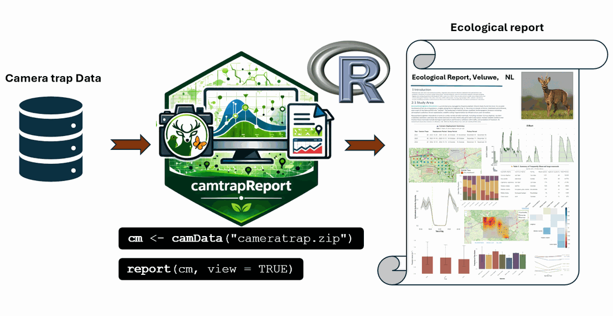
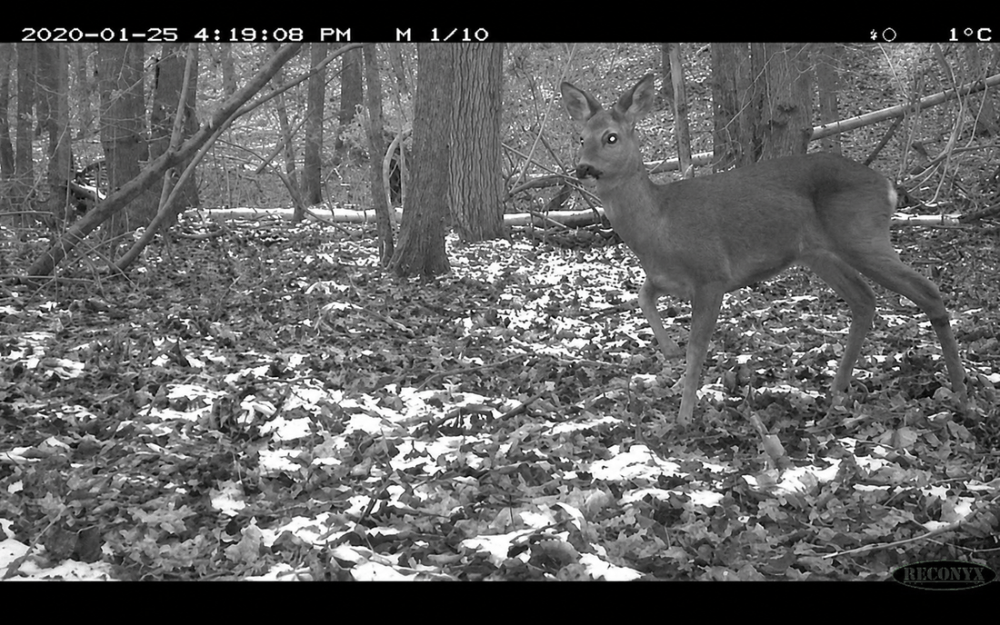
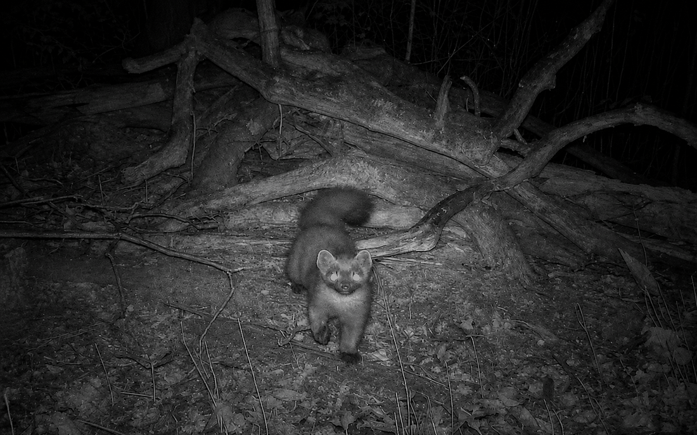
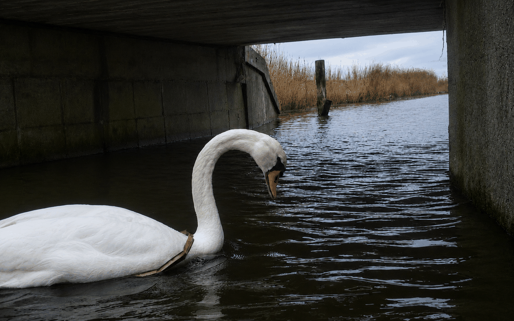
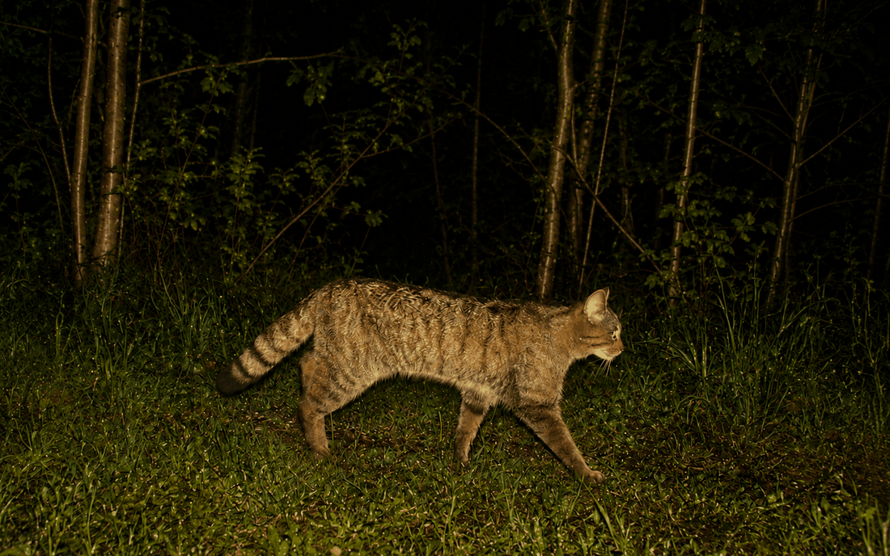
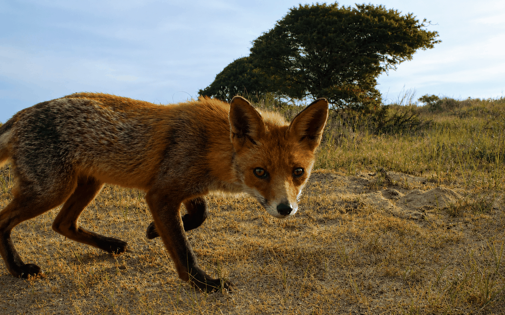

## From camera-trap data to ecological reporting

The **Ecological Report** integrates camera-trap data, sampling summaries, ecological analyses, maps, figures, and data-informed narratives into a reproducible, modular HTML report. Users can customise its content to suit different monitoring objectives, datasets, and analytical requirements.

A [Data Status Check](data-status-report.html) is recommended before ecological analysis to identify potential data-quality issues.

### Reporting workflow

**Prepare → Check → Configure → Report**

Import Camtrap DP data using `camData()`, assess data quality with `status()`, select relevant modules and analytical settings, and generate the Ecological Report using `report()`.

The diagram shows how the selected modules contribute to report generation.

<style>
.figure .caption,
figcaption,
p.caption {
  text-align: center;
  font-size: 0.85rem;
  font-weight: 500;
  color: #555555;
}
</style>

```{r ecological-report-workflow, echo=FALSE, out.width="100%", fig.align="center", fig.cap="Figure 1. Workflow from Camtrap DP inputs and report configuration to an Ecological Report.", fig.alt="Workflow for generating an Ecological Report from camera-trap data using camtrapReport."}

```


### Generate your first report

This example uses the bundled Camtrap DP dataset, habitat data, and study-area boundary. The dataset is copied to a writable folder to protect the installed package files.

```{r ecological-report-basic-code, eval=FALSE}
library(camtrapReport)

# Prepare a writable copy of the example dataset
example_root <- tempfile("camtrapReport-example-")
dir.create(example_root)

file.copy(
  system.file("external", "dataset", package = "camtrapReport"),
  example_root,
  recursive = TRUE
)

# Load supplementary data
habitat <- read.csv(
  system.file("external", "habitat", "habitat.csv",
              package = "camtrapReport")
)

study_area <- system.file(
  "external", "study_area", "study_area.shp",
  package = "camtrapReport"
)

# Import data and generate reports
cm <- camData(
  data = file.path(example_root, "dataset"),
  habitat = habitat,
  study_area = study_area
)

status(cm, view = FALSE)  # Assess data quality
report(cm, view = TRUE)   # Generate and open the Ecological Report
```

### Save the report

By default, the report is saved in `cm$info$directory`, the object's data directory. Use `filename` to specify an output location and `view = FALSE` to generate the report without opening it. The destination directory must already exist.

```{r ecological-report-output-path, eval=FALSE}
dir.create("reports", recursive = TRUE, showWarnings = FALSE)

report_file <- report(
  cm,
  filename = "reports/ecological_report_2026",
  view = FALSE
)
```

**Note:** Existing output files and intermediate R Markdown sources are protected by default (`overwrite = FALSE`). Use distinct filenames for different reports, or set `overwrite = TRUE` explicitly when replacement is intended.

### Report content and customisation

The Ecological Report supports analyses of sampling effort, species detections, richness, activity patterns, co-occurrence, habitat associations, and population density. **Available outputs depend on the selected modules, data, and analytical requirements.**

Explanatory text draws on module templates, dataset metadata, and computed results; review it before sharing.

Explore the [Module Catalog](module-catalog.html) for available analyses, [Analytical Profiles](profiles.html) for reusable configurations, and [Module Management](modules.html) for customisation.

---

## Explore example ecological reports

Explore Ecological Reports from different monitoring projects. Select a preview to open the corresponding HTML report and see how analyses and outputs vary across datasets.

<style>

.eco-gallery {

  display: grid;

  grid-template-columns: repeat(2, minmax(0, 1fr));

  gap: 1.5rem;

  max-width: 1050px;

  margin: 1.8rem auto 2.8rem auto;

}

.eco-card {

  position: relative;

  display: block;

  overflow: hidden;

  border-radius: 18px;

  background: #003b32;

  box-shadow: 0 8px 24px rgba(0, 0, 0, 0.16);

  text-decoration: none;

  color: #ffffff !important;

}

.eco-card img {

  width: 100%;

  height: 320px;

  object-fit: cover;

  display: block;

  transition: transform 0.25s ease, filter 0.25s ease;

}

.eco-card:hover img {

  transform: scale(1.05);

  filter: brightness(1.06);

}

.eco-card-overlay {

  position: absolute;

  inset: 0;

  background: linear-gradient(

    to top,

    rgba(0, 0, 0, 0.88),

    rgba(0, 0, 0, 0.42),

    rgba(0, 0, 0, 0.06)

  );

  display: flex;

  flex-direction: column;

  justify-content: flex-end;

  padding: 1.25rem;

}

.eco-card .eco-card-title {

  margin: 0 0 0.25rem 0;

  color: #ffffff !important;

  font-size: 1.35rem;

  line-height: 1.25;

  font-weight: 800 !important;

  text-shadow: 0 2px 8px rgba(0, 0, 0, 0.85);

}

.eco-card .eco-card-text {

  margin: 0;

  color: #ffffff !important;

  font-size: 1rem;

  line-height: 1.35;

  font-weight: 700 !important;

  text-shadow: 0 2px 8px rgba(0, 0, 0, 0.85);

}

.eco-card .eco-card-badge {

  display: inline-block;

  width: fit-content;

  margin-top: 0.75rem;

  padding: 0.30rem 0.80rem;

  border-radius: 999px;

  background: rgba(0, 0, 0, 0.35);

  border: 1px solid rgba(255, 255, 255, 0.75);

  color: #ffffff !important;

  font-size: 0.88rem;

  font-weight: 700 !important;

  text-shadow: 0 1px 5px rgba(0, 0, 0, 0.85);

}

.eco-card:hover,

.eco-card:focus,

.eco-card:hover .eco-card-title,

.eco-card:hover .eco-card-text,

.eco-card:hover .eco-card-badge {

  color: #ffffff !important;

  text-decoration: none;

}

.eco-card:last-child {

  grid-column: 1 / -1;

  width: calc(50% - 0.75rem);

  justify-self: center;

}

@media (max-width: 800px) {

  .eco-gallery {

    grid-template-columns: 1fr;

    max-width: 560px;

  }

  .eco-card:last-child {

    grid-column: auto;

    width: 100%;

  }

  .eco-card img {

    height: 300px;

  }

}

</style>

<div class="eco-gallery">

<a class="eco-card" href="https://spatialecology.github.io/camtrapReport/reports/leuven-ecological-report.html" target="_blank" rel="noopener noreferrer"><div class="eco-card-overlay"><div class="eco-card-title">Leuven</div><div class="eco-card-text">Belgium</div><span class="eco-card-badge">Open report</span></div></a>

<a class="eco-card" href="https://spatialecology.github.io/camtrapReport/reports/antwerp-ecological-report.html" target="_blank" rel="noopener noreferrer"><div class="eco-card-overlay"><div class="eco-card-title">Antwerp</div><div class="eco-card-text">Belgium</div><span class="eco-card-badge">Open report</span></div></a>

<a class="eco-card" href="https://spatialecology.github.io/camtrapReport/reports/mica-ecological-report.html" target="_blank" rel="noopener noreferrer"><div class="eco-card-overlay"><div class="eco-card-title">MICA Monitoring Project</div><div class="eco-card-text">Europe</div><span class="eco-card-badge">Open report</span></div></a>

<a class="eco-card" href="https://spatialecology.github.io/camtrapReport/reports/luxembourg-ecological-report.html" target="_blank" rel="noopener noreferrer"><div class="eco-card-overlay"><div class="eco-card-title">Lux National Monitoring</div><div class="eco-card-text">Luxembourg</div><span class="eco-card-badge">Open report</span></div></a>

<a class="eco-card" href="https://spatialecology.github.io/camtrapReport/reports/amsterdam-ecological-report.html" target="_blank" rel="noopener noreferrer"><div class="eco-card-overlay"><div class="eco-card-title">Amsterdam Water Supply Dunes</div><div class="eco-card-text">Netherlands</div><span class="eco-card-badge">Open report</span></div></a>

</div>

<hr class="section-divider">

## Configure the Ecological Report

Customise report metadata, focal species groups, years, filters, and sections through the `camReport` object. **The following examples are independent**; adapt species, years, file paths, and settings to your own dataset.

### Report metadata

Use `info()` to inspect and update report information, including titles, authors, institutional affiliations, and logos.

```{r ecological-report-metadata, eval=FALSE}
# Inspect metadata
info(cm)

# Update selected fields
info(cm, name = "title") <- "Wildlife Monitoring Report"
info(cm, name = "subtitle") <- "Ecological assessment of camera-trap data"
info(cm, name = "authors") <- c("Elham Ebrahimi", "Patrick Jansen")
info(cm, name = "institute") <- "Utrecht University"
info(cm, name = "siteName") <- "Hoge Veluwe National Park"
info(cm, name = "logoPath") <- "path/to/logo.png"
```

### Focus groups

Focus the report on an available taxonomic or ecological group, or define a group of interest.

```{r ecological-report-focus-groups, eval=FALSE}
# Explore available groups
names(cm$group_definition)

# Select an existing group
cm$set_focus_group(x = "birds")
cm$setup()

# Inspect a group definition
cm$get_group("birds")
```

To define a custom species group:

```{r ecological-report-custom-group, eval=FALSE}
cm$add_group(
  name = "target_species",
  x = list(
    scientificName = c(
      "Vulpes vulpes",
      "Capreolus capreolus",
      "Sus scrofa"
    )
  )
)

cm$set_focus_group(x = "target_species")
cm$setup()
```

### Monitoring years and filters

Select the monitoring period and adjust the minimum observation-count filter to suit the analytical objectives.

```{r ecological-report-years-filters, eval=FALSE}
# Inspect available years
cm$extractYears()

# Select years and refresh the configuration
cm$years <- 2023:2024
cm$setup()

# Set the minimum observation count
cm$filterCount <- 10
```

Choose years present in the dataset and a threshold appropriate for your analysis.

### Report sections

Select the analyses and sections to include in the final report.

```{r ecological-report-select-sections, eval=FALSE}
# Inspect available sections
section_names(object = cm, profile = "default")
listReportSections(cm)

# Exclude selected analyses
selected <- section_names(
  object = cm, profile = "default",
  exclude = c("richness", "co_occurrence")
)

# Apply the configuration
sections(cm, selected, profile = "default")

# Generate the customised report
report(cm, filename = "ecological_custom", view = TRUE)

# To reset the section configuration, reapply the original profile
# or a previously saved selection of sections.
```

### Reuse and extend configurations

**Analytical Profiles** provide reusable selections of modules for different monitoring workflows. Analytical methods and settings are defined through the associated modules and report configuration. See [Analytical Profiles](profiles.html).

To modify existing analyses or develop new modules, work in a writable project directory rather than editing installed package files. See [Module Management](modules.html).

### Interpretation and reproducibility

Interpret outputs in light of sampling design, effort, detectability, and method-specific assumptions. Capture-based indices are not direct measures of abundance; density models require suitable data and parameterisation.

Missing outputs may reflect unmet prerequisites rather than ecological absence. Review methods and generated narratives, retain data and settings for reproducibility, and protect sensitive species locations when sharing. Consult the [Module Catalog](module-catalog.html) for module requirements.
