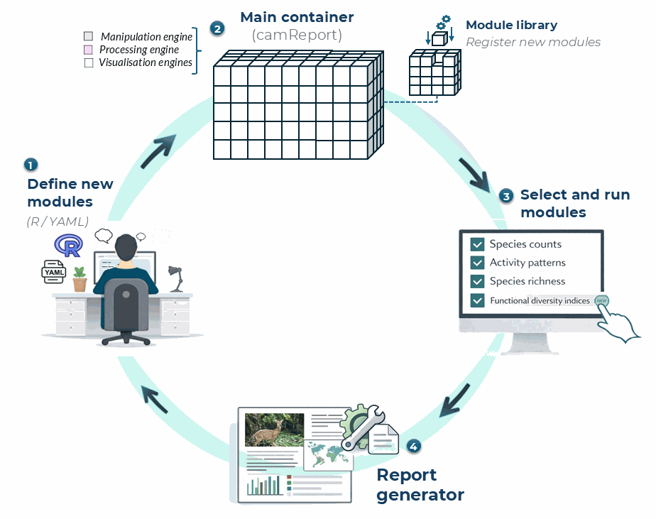
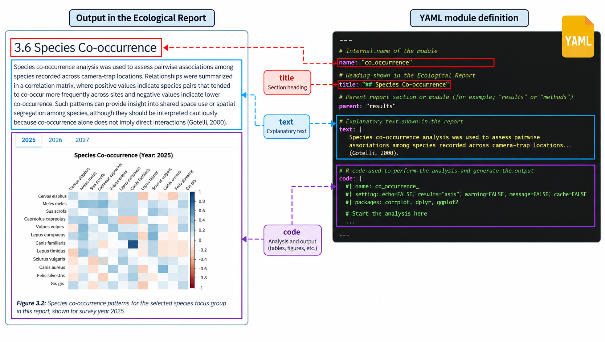

## Managing and extending report modules

The Ecological Report is built from separate report sections, here referred to as modules. Each module is a small report component that can contain explanatory text, R code, or both. This modular structure allows users to extend the report by adding new sections, modifying existing ones, or changing the order in which sections appear.

A new module is defined in a YAML file and then registered with `camtrapReport` using `add_Module()`. After the module has been added, it is useful to test it before generating the full report.

Work in a writable project copy of the registry, not the installed package
directory: package updates replace installed files. Modules contain real R
code, including expressions embedded in their narrative text. Inspect their
code, package requirements, network requests, and file operations, and only
run modules from sources you trust. A profile selects modules; it does not
sandbox their execution.

## Editing existing modules

The narrative shown in a report comes from YAML `text` fields, R code that
prints text, and metadata/text stored in the `camReport` object. Existing
modules can be customised. For a change to the current report only, select
the sections first and then update the attached section:

```{r edit-current-section, eval=FALSE}
sections(cm, "introduction")
updateReportSection(
  cm,
  section = "introduction",
  text = "This report documents the camera-trap survey at our study site."
)
report(
  cm,
  filename = file.path(tempdir(), "edited-introduction.html"),
  view = FALSE
)
```

This replaces the section's static text; any retained code can still print
additional narrative. `updateReportSection()` can also replace a code chunk.
It changes the attached report section, rather than the installed YAML file.
Apply such edits after selecting modules: passing a `profile` to `report()`
rebuilds the attached selection from the module pool and can replace edits to
the current tree.

To share a reusable YAML variant, copy a bundled YAML to your project, give
it a unique filename and internal `name` (for example,
`introduction_project`), edit its `text` and/or `code`, and add it to your
writable registry using the workflow below. Keep parent names consistent and
test the edited module before rendering. A copied registry is not loaded
automatically by `camData()` or `setup()`; `add_Module()` returns the parsed
module so you can attach it explicitly to the current object.


<style>
.figure .caption,
figcaption,
p.caption {
  text-align: center;
  font-size: 0.85rem;
  font-weight: 500;
  color: #555555;
}
</style>

```{r module-workflow, echo=FALSE, out.width="85%", fig.align="center", fig.cap="Figure 1. Modular workflow for defining, registering, selecting, and running report modules in *camtrapReport*.", fig.alt="Modular workflow for defining, registering, selecting, and running report modules in camtrapReport."}

```

Figure 1 summarises how new modules are added to the report workflow. A module can be defined using R code or a YAML file, registered in the module library, added to the main `camReport` object, tested separately, and then included when generating the final Ecological Report.

### 1. List existing modules

Before adding a new module, check which modules are already available in the package.

```{r list-existing-modules, eval=FALSE}
# List all available modules
list_Modules()

# Show all section names used in the report
section_names()
```

The table form, `list_Modules(tree = FALSE)`, includes a `formats` column. Its
value is `html`, `pdf`, or `both`. Report generation uses this value to omit a
module that is incompatible with the requested output and also omits any child
whose parent is unavailable. Existing three-column registries remain valid and
default to `both`.

### 2. Create a new module YAML file

A module can be written as a YAML file. Figure 2 illustrates how the main
components of a YAML module correspond to the content generated in the
Ecological Report.

```{r yaml-module-structure, echo=FALSE, out.width="100%", fig.align="center", fig.cap="Figure 2. Relationship between the main components of a YAML report module and its output in the Ecological Report.", fig.alt="Diagram showing how the main components of a YAML report module correspond to the heading, explanatory text, and analytical output in the Ecological Report."}

```

The example below defines a simple module called `species_table`, which adds a
species summary table to the Ecological Report.

Create a file called `species_table.yml` in a writable project directory.
The example below uses `project_dir` for that directory; replace the temporary
directory with a deliberate project path if you want to retain your modules.

```{r create-module-workspace, eval=FALSE}
project_dir <- tempfile("camtrapReport-modules-")
dir.create(project_dir)
module_file <- file.path(project_dir, "species_table.yml")
```

Save the following YAML content at `module_file` before running the next step.

~~~yaml
name: species_table
title: "Species summary table"
parent: "results"
formats: "both"
text: "This section provides a summary of the species detected in the camera-trap dataset, including their taxonomy and total number of captures."

code: |
  #| echo: false
  #| message: false
  #| warning: false

  species_table <- object$data_status$Species$Table

  if (!is.null(species_table) && nrow(species_table) > 0) {
    knitr::kable(
      species_table,
      caption = "Species detected in the camera-trap dataset."
    )
  } else {
    cat("No species table is available for this dataset.")
  }
~~~

### 3. Add the new module

Module registries that are changed by users must be kept outside the installed
package directory. Start by copying the bundled registry to a writable project
directory, then add the new module to that copy. In this example,
`species_table` is placed before the `richness` section.

```{r add-new-module, eval=FALSE}
# Create a writable project-level module registry once
bundled_modules <- system.file(
  "reportSections",
  package = "camtrapReport"
)
module_dir <- file.path(project_dir, "reportSections")

if (!dir.exists(module_dir)) {
  dir.create(module_dir)
  file.copy(
    list.files(bundled_modules, full.names = TRUE),
    module_dir,
    recursive = TRUE
  )
}

# Add a new module from a YAML file
added <- add_Module(
  x = module_file,
  before = "richness",
  test = FALSE,
  object = cm,
  formats = "both",
  dir = module_dir
)

# Check whether the module has been added
list_Modules(dir = module_dir)
```

You can change `before = "richness"` to another section name if you want the new module to appear elsewhere in the report.

The `formats` argument can be omitted when the YAML contains a top-level field
such as `formats: "html"`; if neither is supplied, the module defaults to
`both`. `move_Module(..., formats = "pdf")` can update the compatibility value
while repositioning an existing module. Removing and restoring modules
preserves the value in the trash index.

### 4. Install module dependencies

When a module is added with add_Module(), its package requirements are registered automatically. Use install_all() to install any missing packages required by the bundled and user-added modules.

```{r install-module-dependencies, eval=FALSE}
# Discover and install all dependencies declared by all modules
install_all()
```

#### Inspect dependencies without installing

Read a module's package declarations before deciding what to install. This
example only prints the declarations in your copied YAML files:

```{r inspect-module-dependencies, eval=FALSE}
yaml_files <- list.files(
  module_dir,
  pattern = "\\.ya?ml$",
  full.names = TRUE
)
declarations <- lapply(yaml_files, function(file) {
  grep(
    "^\\s*#\\|\\s*packages:",
    readLines(file, warn = FALSE),
    value = TRUE
  )
})
names(declarations) <- basename(yaml_files)
declarations[lengths(declarations) > 0L]

# Check selected names from a declaration without installing or attaching:
pkgs <- c("ggplot2", "dplyr")
pkgs[!vapply(pkgs, requireNamespace, logical(1), quietly = TRUE)]
```

`install_all()` scans the bundled/registered module requirements, not every
arbitrary folder containing YAML files. When working with a separate copied
registry, inspect its declarations and explicitly supply additional package
names through `install_all(pkgs = ...)` if needed.

### 5. Add the module to the current camReport object

The object returned by `add_Module()` contains the parsed module. Attach it to
the current report object and confirm that it appears in the report catalogue.

```{r update-current-object, eval=FALSE}
cm$addReportObject(added$module)
listReportSections(cm)
```

### 6. Test the new module

Before generating the full report, test only the new module. This is useful for checking whether the YAML structure, text, and R code work correctly.

```{r test-new-module, eval=FALSE}
# Test the new module only
testSection(
  added$module,
  object = cm,
  view = TRUE
)
```

If the module opens correctly in the browser, it can be included in the full report.

### 7. Generate the full report

After testing, generate the full Ecological Report with the new module included.

```{r generate-report-with-new-module, eval=FALSE}
# Generate the full report
report(
  cm,
  filename = file.path(tempdir(), "project-ecological-report.html"),
  view = TRUE
)
```

This workflow allows users to extend the Ecological Report with project-specific outputs, additional summaries, new figures, or custom interpretation sections.

The attachment above affects the current report tree. It does not add the
module to a named profile's source pool. Render that tree without a `profile`
argument; applying a profile again replaces the current selection. Retain the
YAML file and repeat its registration/attachment when constructing a new
object. Re-running `setup()` reloads the bundled module pools.

## Defining and sharing report profiles

All YAML modules remain in their report or status module pool. A profile stores
only an ordered selection from those pools, so alternative introductions,
methods, or result modules can coexist without all appearing in every report.
Each module still needs a unique internal `name` within its pool.

See the dedicated [Report profiles guide](https://spatialecology.github.io/camtrapReport/articles/profiles.html)
for a complete reusable example and the difference between module pools and
the current attached report tree.

```{r define-report-profile, eval=FALSE}
project_profile <- reportProfile(
  name = "project",
  description = "A project-specific ecological and status report",
  report = c(
    "report::introduction",
    "report::methods",
    "report::results",
    "report::appendix"
  ),
  status = c(
    "status::abstract",
    "status::availability"
  )
)

add_profile(cm, project_profile)
report(
  cm,
  profile = "project",
  filename = file.path(tempdir(), "profile-project-report.html")
)
status(
  cm,
  profile = "project",
  filename = file.path(tempdir(), "profile-project-status.html")
)
```

The `parent` column can override a module's YAML parent for one profile. For
example, this places selected status modules below the ecological appendix
without editing their source files:

```{r cross-pool-profile, eval=FALSE}
main_entries <- data.frame(
  source = c("report", "report", "status", "status"),
  module = c("introduction", "appendix", "spatial", "temporal"),
  parent = c(NA, NA, "appendix", "appendix")
)

combined_profile <- reportProfile(
  name = "combined",
  report = main_entries
)
```

Profiles are ordinary YAML files and can be versioned or shared beside custom
module files. Reading a profile does not execute its modules.

```{r share-report-profile, eval=FALSE}
profile_file <- file.path(project_dir, "project-profile.yml")
write_profile(project_profile, profile_file)
shared_profile <- read_profile(profile_file)
# Replace the profile named "project" registered in the previous example.
add_profile(cm, shared_profile, overwrite = TRUE)
```

## Reordering, removing, and restoring modules

Module changes can be inspected and reversed before anything is deleted permanently:

```{r manage-existing-modules, eval=FALSE}
# Validate active module definitions and inspect the hierarchy
list_Modules(validate = TRUE, dir = module_dir)

# Move a module within the report hierarchy
move_Module(
  "species_table",
  after = "captures",
  parent = "results",
  dir = module_dir
)

# Move a module and its children to the module trash
remove_Module("species_table", recursive = TRUE, dir = module_dir)

# Inspect active and deleted modules
list_Modules(include_trash = TRUE, dir = module_dir)

# Restore a removed module
restore_Module("species_table", test = TRUE, dir = module_dir)
```

`empty_trash()` permanently deletes trashed module definitions and should only
be used after confirming that the YAML files are backed up elsewhere. Changes
to a copied registry do not automatically update a `camReport` object. Attach
the returned module explicitly when adding one, confirm the current selection
with `listReportSections(cm)`, test affected modules, and generate the report
in a new output file. Review the resulting text, tables, figures, warnings,
and citations as carefully as any manually written scientific analysis.
